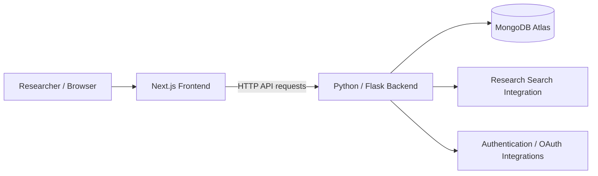

<div align="center">

# Brainiacs Atlas

### Full-Stack Neuroscience Research Web Application

**An interactive web platform for exploring Swanson's Rat Brain Atlas, organizing research notes, and discovering scientific literature.**

**Next.js · React · TypeScript · Python · Flask · MongoDB Atlas**

[Explore Features](#key-features) · [Architecture](#system-architecture) · [Getting Started](#getting-started) · [Video Demonstrations](#video-demonstrations)

</div>

---

## Overview

**Brainiacs Atlas** is a team-developed research platform that provides an online interface to **Swanson's Rat Brain Atlas**. It combines anatomical visualization with research workflows in a full-stack web application.

The project brings together an interactive brain atlas, region information, researcher notes and collections, an integrated library, and literature search features. Its frontend is built with Next.js and its Python/Flask backend interacts with a cloud-hosted MongoDB database.

> **Project context:** Developed as part of the University of Texas at El Paso's Software Engineering Practicum (Team 2, Fall 2025). This repository is a portfolio presentation of a collaborative project. Individual contributions are identified separately below.

## Application Preview

### Landing Page and Authentication


### Dual-View Atlas


> These screenshots are from the original project documentation. Additional current screenshots can be placed in `docs/screenshots/` and linked here.

## Key Features

| Area | Capability |
| --- | --- |
| **Interactive Brain Atlas** | Navigate anatomical atlas views and inspect region-specific information. |
| **Dual-View Visualization** | Explore anatomical views side by side. |
| **Research Notes & Collections** | Create and organize notes and research collections. |
| **Research Library** | Use a dedicated interface for managing research material. |
| **Scientific Literature Search** | Search for research papers through the application's search workflow. |
| **Image Workflows** | Support image uploads and processing through dedicated application modules. |
| **Authentication & Administration** | Login/registration functionality and administrative interfaces. |

The repository also includes modules for image warping, whiteboard interaction, sharing, and application security. Document their exact behavior and implementation details after confirming them in the source code.

## Technology Stack

| Layer | Technologies |
| --- | --- |
| Frontend | Next.js, React, TypeScript, Tailwind CSS |
| Backend | Python, Flask |
| Database | MongoDB Atlas |
| Authentication | Application authentication routes; Google and ORCID OAuth configuration |
| Integrations | SerpAPI search integration |
| Development | Git, GitHub, Node.js, Python virtual environments |

**Version note:** The frontend was observed running with Next.js **14.2.33** in a local development session. Consult `atlas-frontend/package.json` and its lockfile for authoritative dependency versions; the original team README contains outdated version labels.

## System Architecture



**Frontend:** Presents the atlas, visualization controls, research workflows, and account interfaces.  
**Backend:** Exposes the application's API routes and coordinates business logic, data access, authentication, and image-related operations.  
**Database:** Stores application and atlas data used by backend features.  
**External services:** Support search and authentication features where configured.

> This is a high-level architecture based on the repository layout and original setup instructions. Exact route paths and deployment topology should be verified from the source before expanding this diagram.

## Repository Structure

```text
Brainiacs-Atlas-Web-Application/
├── atlas-frontend/          # Next.js application and visual components
│   ├── app/
│   ├── components/
│   ├── pages/
│   └── public/
├── atlas-backend/           # Flask API and application services
│   ├── db_handler/          # MongoDB data-access modules
│   ├── routes/              # Feature-specific API routes
│   ├── security/            # Security-related modules
│   ├── main.py              # Flask application entry point
│   ├── create_db.py         # Region-data import script
│   ├── database.jsonl       # Source data, if included in your copy
│   └── requirements.txt
├── README.md
└── LICENSE
```

## Getting Started

### Prerequisites

- Node.js and npm (the original project used Node.js 22.14.0)
- Python 3.10 or 3.11
- MongoDB Atlas cluster and application database user
- API credentials for any optional integrations you intend to test

### 1. Clone the repository

```powershell
git clone https://github.com/agrobles156/Brainiacs-Atlas-Web-Application.git
cd Brainiacs-Atlas-Web-Application
```

### 2. Set up the backend

Open a PowerShell terminal at the repository root:

```powershell
cd atlas-backend
py -3.11 -m venv .venv
.\.venv\Scripts\Activate.ps1
python -m pip install -r requirements.txt
Copy-Item .env.example .env
```

Update `.env` with **your own** MongoDB Atlas connection string, Flask secret, and any service credentials needed by the features you plan to use. **Never commit `.env` or real credentials.** Keep `.env.example` populated with placeholders only.

If you are working with a **new, empty database**, the project includes a seed script that reads `database.jsonl` and inserts documents into a `regions` collection:

```powershell
python create_db.py
```

**Run the import only when needed.** The existing script uses bulk insertion and may duplicate region documents if repeated. Ensure the source dataset is present and that `db_handler/connection_db.py` selects the correct database.

Then start the backend:

```powershell
python main.py
```

### 3. Start the frontend

Open a **second** PowerShell terminal at the repository root:

```powershell
cd atlas-frontend
npm ci
npm run dev
```

Open the URL printed by Next.js (typically **http://localhost:3000**).

### 4. Confirm local configuration

The original team deployment used hosted API and OAuth callback URLs. For a local setup, verify the frontend's API configuration and Flask routes before replacing production URLs with localhost equivalents. OAuth providers may also require matching callback URLs in their dashboards.

## Video Demonstrations

The original project includes walkthroughs of its main workflows:

| Demonstration | Video |
| --- | --- |
| Complete Application Walkthrough | [Watch on YouTube](https://youtu.be/iJ6jixH6vHQ) |
| Landing Page, Login & Registration | [Watch on YouTube](https://youtu.be/RCKbi008s84) |
| Interactive Atlas | [Watch on YouTube](https://youtu.be/_0CDLhfI9Ds) |
| Notes & Collections | [Watch on YouTube](https://youtu.be/kt2rYZDnPYM) |
| Research Library | [Watch on YouTube](https://youtu.be/lcVTi4QJHz0) |
| Paper Search | [Watch on YouTube](https://youtu.be/dFv1KFq0kfg) |
| Admin Dashboard | [Watch on YouTube](https://youtu.be/PHjPU4BYS1E) |

## My Contributions

**To complete before public portfolio use:** Clearly describe the features you personally designed, implemented, tested, or maintained. This was a collaborative project; avoid attributing the team's entire codebase to one developer.

Suggested format:

- **Feature / subsystem:** What you owned and the technical problem it solved.
- **Implementation:** Technologies, algorithms, design decisions, and integration points you worked on.
- **Verification:** How you tested, debugged, or validated the implementation.
- **Collaboration:** How you coordinated changes, reviews, and integration with teammates.

## Project Background & Attribution

Brainiacs Atlas originated as a collaborative **UTEP Software Engineering Practicum** project developed by Team 2 in Fall 2025. Credit for original team work remains with its contributors. Review the repository's existing `LICENSE` and project/team permissions before publicly redistributing the source code or associated atlas assets.

---

<div align="center">

**Brainiacs Atlas** · Full-stack research software · [GitHub Repository](https://github.com/agrobles156/Brainiacs-Atlas-Web-Application)

</div>
