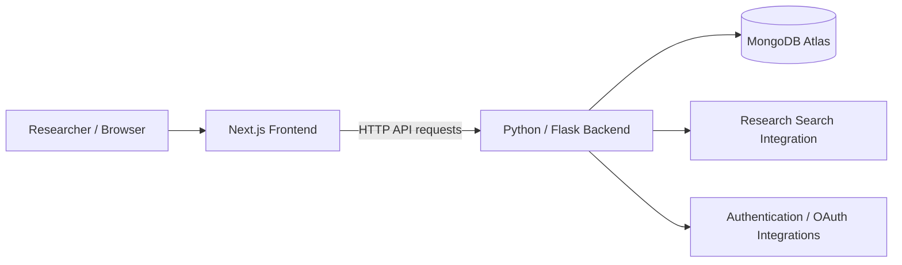

<div align="center">

# Brainiacs Atlas

### Full-Stack Neuroscience Research Web Application

**An interactive web platform for exploring Swanson's Rat Brain Atlas, organizing research notes, and discovering scientific literature.**

**Next.js · React · TypeScript · Python · Flask · MongoDB Atlas**

[Explore Features](#key-features) · [Architecture](#system-architecture) · [Getting Started](#getting-started) · [Video Demonstrations](#video-demonstrations)

</div>

---

## Overview

**Brainiacs Atlas** is a team-developed research platform that provides an online interface to **Swanson's Rat Brain Atlas**. It combines anatomical visualization with research workflows in a full-stack web application.

The project brings together an interactive brain atlas, region information, researcher notes and collections, an integrated library, and literature search features. Its frontend is built with Next.js and its Python/Flask backend interacts with a cloud-hosted MongoDB database.

> **Project context:** Developed as part of the University of Texas at El Paso's Software Engineering Practicum (Team 2, Fall 2025). This repository is a portfolio presentation of a collaborative project. Individual contributions are identified separately below.

## Application Preview

### Landing Page and Authentication


### Dual-View Atlas


> These screenshots are from the original project documentation. Additional current screenshots can be placed in `docs/screenshots/` and linked here.

## Key Features

| Area | Capability |
| --- | --- |
| **Interactive Brain Atlas** | Navigate anatomical atlas views and inspect region-specific information. |
| **Dual-View Visualization** | Explore anatomical views side by side. |
| **Research Notes & Collections** | Create and organize notes and research collections. |
| **Research Library** | Use a dedicated interface for managing research material. |
| **Scientific Literature Search** | Search for research papers through the application's search workflow. |
| **Image Workflows** | Support image uploads and processing through dedicated application modules. |
| **Authentication & Administration** | Login/registration functionality and administrative interfaces. |

The repository also includes modules for image warping, whiteboard interaction, sharing, and application security. Document their exact behavior and implementation details after confirming them in the source code.

## Technology Stack

| Layer | Technologies |
| --- | --- |
| Frontend | Next.js, React, TypeScript, Tailwind CSS |
| Backend | Python, Flask |
| Database | MongoDB Atlas |
| Authentication | Application authentication routes; Google and ORCID OAuth configuration |
| Integrations | SerpAPI search integration |
| Development | Git, GitHub, Node.js, Python virtual environments |

**Version note:** The frontend was observed running with Next.js **14.2.33** in a local development session. Consult `atlas-frontend/package.json` and its lockfile for authoritative dependency versions; the original team README contains outdated version labels.

## System Architecture



**Frontend:** Presents the atlas, visualization controls, research workflows, and account interfaces.  
**Backend:** Exposes the application's API routes and coordinates business logic, data access, authentication, and image-related operations.  
**Database:** Stores application and atlas data used by backend features.  
**External services:** Support search and authentication features where configured.

> This is a high-level architecture based on the repository layout and original setup instructions. Exact route paths and deployment topology should be verified from the source before expanding this diagram.

## Repository Structure

```text
Brainiacs-Atlas-Web-Application/
├── atlas-frontend/          # Next.js application and visual components
│   ├── app/
│   ├── components/
│   ├── pages/
│   └── public/
├── atlas-backend/           # Flask API and application services
│   ├── db_handler/          # MongoDB data-access modules
│   ├── routes/              # Feature-specific API routes
│   ├── security/            # Security-related modules
│   ├── main.py              # Flask application entry point
│   ├── create_db.py         # Region-data import script
│   ├── database.jsonl       # Source data, if included in your copy
│   └── requirements.txt
├── README.md
└── LICENSE
```

## Getting Started

### Prerequisites

- Node.js and npm (the original project used Node.js 22.14.0)
- Python 3.10 or 3.11
- MongoDB Atlas cluster and application database user
- API credentials for any optional integrations you intend to test

### 1. Clone the repository

```powershell
git clone https://github.com/agrobles156/Brainiacs-Atlas-Web-Application.git
cd Brainiacs-Atlas-Web-Application
```

### 2. Set up the backend

Open a PowerShell terminal at the repository root:

```powershell
cd atlas-backend
py -3.11 -m venv .venv
.\.venv\Scripts\Activate.ps1
python -m pip install -r requirements.txt
Copy-Item .env.example .env
```

Update `.env` with **your own** MongoDB Atlas connection string, Flask secret, and any service credentials needed by the features you plan to use. **Never commit `.env` or real credentials.** Keep `.env.example` populated with placeholders only.

If you are working with a **new, empty database**, the project includes a seed script that reads `database.jsonl` and inserts documents into a `regions` collection:

```powershell
python create_db.py
```

**Run the import only when needed.** The existing script uses bulk insertion and may duplicate region documents if repeated. Ensure the source dataset is present and that `db_handler/connection_db.py` selects the correct database.

Then start the backend:

```powershell
python main.py
```

### 3. Start the frontend

Open a **second** PowerShell terminal at the repository root:

```powershell
cd atlas-frontend
npm ci
npm run dev
```

Open the URL printed by Next.js (typically **http://localhost:3000**).

### 4. Confirm local configuration

The original team deployment used hosted API and OAuth callback URLs. For a local setup, verify the frontend's API configuration and Flask routes before replacing production URLs with localhost equivalents. OAuth providers may also require matching callback URLs in their dashboards.

## Video Demonstrations

The original project includes walkthroughs of its main workflows:

| Demonstration | Video |
| --- | --- |
| Complete Application Walkthrough | [Watch on YouTube](https://youtu.be/iJ6jixH6vHQ) |
| Landing Page, Login & Registration | [Watch on YouTube](https://youtu.be/RCKbi008s84) |
| Interactive Atlas | [Watch on YouTube](https://youtu.be/_0CDLhfI9Ds) |
| Notes & Collections | [Watch on YouTube](https://youtu.be/kt2rYZDnPYM) |
| Research Library | [Watch on YouTube](https://youtu.be/lcVTi4QJHz0) |
| Paper Search | [Watch on YouTube](https://youtu.be/dFv1KFq0kfg) |
| Admin Dashboard | [Watch on YouTube](https://youtu.be/PHjPU4BYS1E) |


## My Contributions | Full-Stack Software Developer

Contributed extensively to the design, development, and integration of **Brainiacs Atlas**, a full-stack neuroscience research platform developed as part of a collaborative software engineering project.

My responsibilities spanned **frontend development, backend engineering, database architecture, data transformation, scientific information retrieval, computer vision, and application integration**. I contributed to the majority of the platform's core functionality, working alongside team members responsible for dedicated chat and security features.

### Key Engineering Contributions

- **Full-Stack Application Development:** Designed, developed, and integrated application functionality using **React, Next.js, TypeScript, Python, and Flask**, connecting interactive frontend components with RESTful backend services to deliver a cohesive research platform.

- **Database Engineering & Legacy Data Migration:** Transformed anatomical research data from a legacy Microsoft Word document into a structured **JSON/JSONL dataset** suitable for programmatic processing and database ingestion. Developed a **MongoDB database seeding pipeline** to parse, transform, and populate anatomical region records, enabling efficient data retrieval and integration with the interactive brain atlas. This process modernized the handling of legacy scientific data and established a structured foundation for application functionality.

- **Scientific Literature Search & Relevance Optimization:** Developed and refined a scientific literature discovery workflow integrating the **PubMed API**, incorporating **BM25 (Best Matching 25) relevance ranking** and AI-assisted semantic retrieval techniques. Applied information retrieval concepts to improve the ranking and relevance of scientific publications associated with anatomical regions and user research queries, enhancing the application's literature discovery capabilities.

- **Computer Vision & Image Registration:** Applied **computer vision techniques, projective geometry, and homography transformations** to develop image processing and anatomical alignment functionality. Implemented image warping and spatial transformation workflows to support the positioning and comparison of user-uploaded research images against reference brain atlas structures.

- **Interactive Brain Atlas Visualization:** Developed and integrated anatomical visualization features, including interactive region selection, sagittal views, image overlays, opacity adjustments, and region-specific research information. These features allow researchers to explore neuroanatomical structures and interact with associated scientific data.

- **Backend API Development:** Designed and implemented **Flask-based REST API endpoints** supporting anatomical data retrieval, image processing, scientific literature search, research notes, collections, and application workflows. Integrated backend services with frontend components to enable data-driven functionality.

- **Authentication & User Management:** Contributed to user authentication integration and account-management workflows, including support for external identity providers and user-specific application functionality.

- **Research Notes & Data Management:** Developed features allowing users to create, organize, retrieve, and manage research notes and collections associated with anatomical regions and scientific publications.

- **Application Integration & Testing:** Participated in debugging, functional testing, and frontend-backend integration to identify defects, resolve compatibility issues, and improve application stability, functionality, and usability.

---

### Agile Development & Scrum Experience

Applied **Agile Scrum methodologies** throughout the development of Brainiacs Atlas, collaborating with a software engineering team to plan, implement, integrate, and deliver application features through iterative development cycles.

#### Key Responsibilities

- **Sprint Planning & Execution:** Participated in sprint planning, task prioritization, and iterative feature development to coordinate deliverables and maintain project progress.

- **Product Backlog Management:** Collaborated with team members to organize development tasks, track feature requirements, and prioritize implementation activities based on project objectives and technical dependencies.

- **Cross-Functional Team Collaboration:** Coordinated frontend, backend, database, and application integration efforts to maintain compatibility between independently developed software components.

- **Git & Version Control:** Utilized **Git and collaborative branching workflows** to manage source code, integrate team contributions, resolve merge conflicts, and support coordinated development across the project repository.

- **Iterative Testing & Quality Assurance:** Incorporated debugging, functional testing, and team feedback throughout development cycles to identify defects, improve application behavior, and validate completed functionality.

- **Agile Communication & Problem-Solving:** Participated in team discussions, progress updates, and collaborative troubleshooting to address development challenges and maintain alignment with sprint objectives.

#### Professional Development

Working within an Agile Scrum environment strengthened my ability to balance hands-on technical development with team coordination, adapt to evolving project requirements, and contribute to software delivery across multiple interconnected components.

---

### Technical Skills Demonstrated

| Engineering Discipline | Technologies & Concepts |
|------------------------|-------------------------|
| **Frontend Development** | React, Next.js, TypeScript, Tailwind CSS |
| **Backend Development** | Python, Flask, RESTful APIs |
| **Database Engineering** | MongoDB Atlas, NoSQL, JSON/JSONL, Data Transformation, Database Seeding |
| **Information Retrieval & AI** | BM25 Ranking, Semantic Search, PubMed API, Relevance Optimization |
| **Computer Vision** | Homography, Projective Transformations, Image Warping, Image Registration |
| **Cloud & Infrastructure** | AWS, Cloud-Hosted Databases, Environment Configuration |
| **Software Engineering** | Agile Scrum, SDLC, Git, Version Control, Integration Testing, Debugging |

---

### Team Collaboration

Brainiacs Atlas was developed collaboratively as part of a university software engineering project.

My contributions encompassed the majority of the application's core engineering functionality, including **full-stack application development, database engineering, scientific literature search, image processing, and interactive visualization**.

Other team members primarily developed the dedicated **chat functionality and security features**, with ongoing collaboration across shared application components and integration workflows.

## Project Background & Attribution

Brainiacs Atlas originated as a collaborative **UTEP Software Engineering Practicum** project developed by Team 2 in Fall 2025. Credit for original team work remains with its contributors. Review the repository's existing `LICENSE` and project/team permissions before publicly redistributing the source code or associated atlas assets.

---

<div align="center">

**Brainiacs Atlas** · Full-stack research software · [GitHub Repository](https://github.com/agrobles156/Brainiacs-Atlas-Web-Application)

</div>
